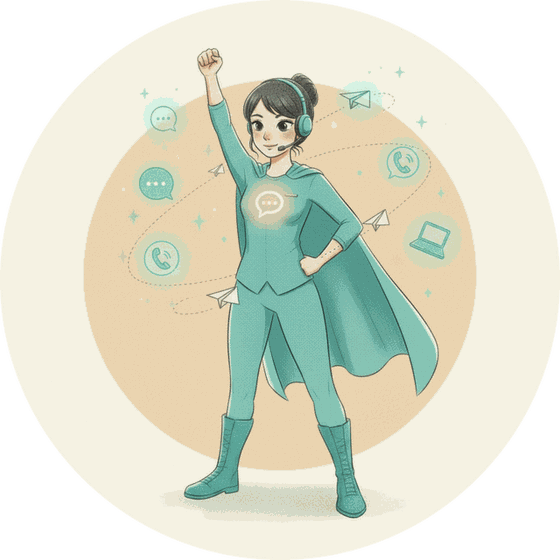

<p align="center">
  <a href="https://milaagent.com"></a>
</p>

<h1 align="center">Mila Agent</h1>

<p align="center"><b>Turn Claude Code into an employee that lives in Telegram.</b><br>
Free, open source, Apache-2.0. Made with ❤️ in Uzbekistan.</p>

<p align="center">She works with you and your team in Telegram — your DMs and the groups you connect — and remembers every promise. A send-guard stops accidental leaks; in the container (Mila Agent) your keys stay with a key keeper she uses but cannot read. Ordinary replies in chats you connected go without asking.</p>

<p align="center">
  <a href="#quick-start"><b>Install</b></a> ·
  <a href="docs/THREAT-MODEL.md"><b>Threat model</b></a> ·
  <a href="docs/README.md"><b>Docs</b></a> ·
  <a href="https://github.com/shakhruz/mila-agent/discussions"><b>Community</b></a> ·
  <a href="https://milaagent.com">milaagent.com</a> ·
  <a href="https://mila.market">Mila Market</a> ·
  <a href="https://milagpt.io/akselerator/">MilaGPT Studio</a>
</p>

<p align="center">
  <a href="https://github.com/shakhruz/mila-agent/tags"></a>
  <a href="https://github.com/shakhruz/mila-agent/actions/workflows/tests.yml"></a>
  <a href="LICENSE"></a>
  
</p>

<p align="center"><b>English</b> · <a href="README.zh-CN.md">中文</a> · <a href="README.ru.md">Русский</a> · <a href="README.uz.md">Oʻzbekcha</a></p>

```sh
curl -fsSL https://github.com/shakhruz/mila-agent/releases/latest/download/get.sh | bash
```
<p align="center">Installs the latest release tag, not <code>main</code>. Runs as a Claude Code development channel (research preview) — see <a href="SECURITY.md#the-development-channels-flag">why</a>.</p>
<p align="center">≈ 5 minutes · macOS, Linux (Windows via WSL) · bring your own Claude plan or Anthropic API key<br>
<a href="https://github.com/shakhruz/mila-agent/releases/latest">Latest release</a> · the install link is checked daily by CI</p>

<p align="center">Questions and ideas: <a href="https://github.com/shakhruz/mila-agent/discussions">GitHub Discussions</a>.</p>

<p align="center"></p>

---

## Why Mila

Most open agents are universal assistants: powerful, if you tell them exactly what to do.
Mila is built the other way round — **a colleague with a job.**

- **Works in your Telegram** — your DMs and the groups you connect, day and night, in the language people write in. Strangers who write to your bot in a DM get no answer yet — see [what Mila can and cannot do](docs/WHAT-MILA-CAN.md).
- **Remembers your business** — every client, conversation and promise; one short summary for you every morning.
- **Asks before the big steps** — a send-guard stops leaks between chats and messages to a chat you have not connected; with the Manager and Images packs, broadcasts and paid generations ask for your ✅ (a skill rule, not a lock — see SECURITY).
- **Yours, 100%** — your files stay in your home folder; `mila export` / `mila restore` moves her to any machine.

```
Customer: Hi! Is the two-bedroom by the sea still free? Can I see it on Saturday?
Mila:     Hi! Yes, it's free 🙂 Saturday at 11:00 or 15:00 — which suits you? I'll book it and remind you an hour before.
Customer: 11, please.
Mila:     Done ✅ I'll send the address and remind you on Saturday morning.
```
*Next morning the owner gets one line: new client · viewing Saturday 11:00 · reminder set.*

## How Mila compares

OpenClaw, NanoClaw and Hermes Agent are excellent open agents — universal assistants for a person. Mila takes a narrower job: a digital employee for a business, on Telegram.

| | **Mila** | [OpenClaw](https://github.com/openclaw/openclaw) | [NanoClaw](https://github.com/nanocoai/nanoclaw) | [Hermes Agent](https://github.com/NousResearch/hermes-agent) |
|---|---|---|---|---|
| What it is | [digital employee for a business](#why-mila) | [universal personal agent](https://github.com/openclaw/openclaw) | [personal agent in containers](https://github.com/nanocoai/nanoclaw) | [personal agent that grows with you](https://hermes-agent.nousresearch.com/docs) |
| Engine | [Claude Code](https://code.claude.com/docs/en/overview) | [own agent loop, models as plugins](https://github.com/openclaw/openclaw) | [Claude Agent SDK](https://github.com/nanocoai/nanoclaw) | [own agent loop, any model](https://hermes-agent.nousresearch.com/docs) |
| Channels | Telegram: DMs, groups, your public bot ([mila-telegram](https://github.com/shakhruz/mila-telegram)) | [20+ (WhatsApp, Telegram, Slack...)](https://docs.openclaw.ai/channels) | [many, each added by a skill](https://github.com/nanocoai/nanoclaw) | [Telegram, Discord, Slack, WhatsApp...](https://hermes-agent.nousresearch.com/docs) |
| Business skills | in the core: [promises and tasks](skills/tasks-discipline/SKILL.md), [owner cards](skills/cards/SKILL.md), [weekly rhythm](canon/WEEK-RHYTHM.md); as [packs](skills/packs/SKILL.md) by the owner's «yes»: [CRM of dialogs](packs/manager/crm-dialogs/SKILL.md), [mailings](packs/manager/bot-send/SKILL.md) | [general skills (ClawHub)](https://clawhub.ai) | [general skills](https://github.com/nanocoai/nanoclaw) | [self-written skills](https://hermes-agent.nousresearch.com/docs) |
| What waits for the owner's yes | partly: [send-guard](templates/home/.claude/hooks/send-guard.py) stops messages to chats the owner didn't connect, keys and internals; with packs, broadcasts and paid generations ask for the owner's ✅ by skill rule ([`bot-send`](packs/manager/bot-send/SKILL.md), [`spend`](packs/kartinki/spend/SKILL.md)); ordinary replies in connected chats are not gated | [exec approvals, Team preset](https://docs.openclaw.ai/tools/exec-approvals) | [approval for credential use, self-modification and new chats; ordinary messages are not gated](https://docs.nanoclaw.dev/concepts/security) | [approval for dangerous shell commands (fail-closed); no approval step for sending messages](https://hermes-agent.nousresearch.com/docs/user-guide/security) |
| License | [Apache-2.0](LICENSE) | [MIT](https://github.com/openclaw/openclaw/blob/main/LICENSE) | [MIT](https://github.com/nanocoai/nanoclaw/blob/main/LICENSE) | [MIT](https://github.com/NousResearch/hermes-agent/blob/main/LICENSE) |

**Mila's honest minuses.** Telegram only: no WhatsApp, Slack or Discord. It needs Claude Code, signed in with your own Claude plan
or API key — this repository runs on Claude only (a guest circuit on other models exists only in the hosted version). She answers while your machine and the session run: a closed laptop means a silent Mila, so use an always-on
computer or a server. macOS and Linux; Windows only through WSL. Channels in Claude Code are a research preview, so the launcher uses a development flag for now
(see Quick start).

Facts about other projects: their READMEs and docs, checked 17.10.2026; approvals row re-checked 21.10.2026 against [NanoClaw security](https://docs.nanoclaw.dev/concepts/security) and [Hermes security](https://hermes-agent.nousresearch.com/docs/user-guide/security) -
[OpenClaw](https://github.com/openclaw/openclaw),
[NanoClaw](https://github.com/nanocoai/nanoclaw), [Hermes Agent](https://github.com/NousResearch/hermes-agent).
Something wrong or out of date? Open an issue - we fix it the same day.


## Mila's values

Every Mila reads one short constitution first: a person's secret stays theirs, «done» only with evidence, nothing goes out on
someone's behalf without their «yes» for this step, money and the irreversible only with the owner's consent, no apologies —
fact, conclusion, next step. The approved text is in Russian ([CONSTITUTION.md](CONSTITUTION.md)), with an English translation
next to it ([CONSTITUTION.en.md](CONSTITUTION.en.md)). How she works day to day is a list of qualities, each a rule and a check by deed
([canon/QUALITIES.md](canon/QUALITIES.md), in Russian) — for example, «I raise the spirit»: words that add confidence and strength, every
fact true, a risk named together with the step through it.

## Claude — by Anthropic's rules

- Mila runs on the ordinary, unmodified Claude Code, installed as Anthropic publishes it.
- You sign in yourself, only on Anthropic's page, with your own Claude plan or your own Anthropic API key. Mila never copies or stores your login or token; don't copy an OAuth token anywhere yourself.
- Your plan is for your own use. Customers and guests who write to your bot are served through an API key, billed to the key's owner.
- A partner who sets Mila up for you does not run you on the partner's subscription, does not pay for, resell or intermediate your Claude usage, and does not collect logins.

Source: [Claude Code — legal and compliance](https://code.claude.com/docs/en/legal-and-compliance).


## Quick start


≈ 5 minutes.

**No computer to keep on?** Mila runs in the cloud too — [Railway or Hostinger, one page](docs/CLOUD.md).

**You need:**
- macOS or Linux. On Windows — inside [WSL](https://learn.microsoft.com/windows/wsl/install).
- [Claude Code](https://code.claude.com/docs/en/setup), a recent release (`claude --version`; older than 2.1.295 installs without the send-guard's `onFailure` key), signed in with your own **paid** Claude plan
  (Pro, Max, Team or Enterprise) or your own Anthropic API key — Mila works all day, so watch your usage
  ([costs](https://code.claude.com/docs/en/costs)). On Team and Enterprise your organization admin must enable channels.
- **Which login for which Mila.** Your own Mila that works for you, in your chats, can run on your own subscription. A Mila that
  answers other people — your customers, guests of a public bot, a company's staff — should run on an Anthropic API key (Claude
  Console or a cloud provider), billed to whoever owns the key: Anthropic's terms keep subscription logins for ordinary individual
  use and do not allow serving other people through them. See
  [Legal and compliance](https://code.claude.com/docs/en/legal-and-compliance#authentication-and-credential-use).
- [Bun](https://bun.sh) and git.
- A Telegram bot token from `@BotFather`.
- `~/.local/bin` on your `PATH` — the `mila` launcher goes there (the installer tells you if it is missing: `export PATH="$HOME/.local/bin:$PATH"`).
- Nothing else: your Telegram id is set by `mila onboard` (step 3). Setting it by hand: `MILA_OWNER_ID=<your id> ~/mila/install/install.sh`.

One command:

```sh
curl -fsSL https://github.com/shakhruz/mila-agent/releases/latest/download/get.sh | bash
```

**Check before running.** Every release carries `get.sh` and `SHA256SUMS` as assets. The checksum is integrity only: it proves
the download is whole, not who made it — both files come from the same release. What does tie the install to the release: the
release notes name the commit of the tag, and that `get.sh` refuses to install if the tag now points to another commit (releases after v1.7.1).
Download, compare, read, then run:

```sh
curl -fsSLO https://github.com/shakhruz/mila-agent/releases/latest/download/get.sh
curl -fsSLO https://github.com/shakhruz/mila-agent/releases/latest/download/SHA256SUMS
sha256sum -c --ignore-missing SHA256SUMS && bash get.sh          # Linux
shasum -a 256 -c --ignore-missing SHA256SUMS && bash get.sh      # macOS
```

Release tags are signed when the maintainer's key is set (`git tag -v vX.Y.Z`); unsigned tags are said so in the release notes.

It checks Claude Code, Bun and git, clones the kit to `~/mila`, runs `install/install.sh` and installs the Telegram plugin `mila-telegram` (existing files are backed up as `<file>.bak-YYYYMMDD-HHMMSS`). Prefer to look first? `curl -fsSL https://github.com/shakhruz/mila-agent/releases/latest/download/get.sh | MILA_INSTALL_ARGS=--dry-run bash` — or clone and run `./install/install.sh --dry-run`: it shows exactly what will be touched.

The screen stays short — a greeting, five check marks, one next step (`mila`). Every file it touched is listed in `~/.claude/mila-install.log` (private, rewritten on each run); `--verbose` (or `MILA_INSTALL_VERBOSE=1`) prints the same lines on the screen.

**What changes on your machine** (`--dry-run` lists every item before anything is written):
- `~/mila` — the kit itself (a git clone);
- `~/.claude/skills/` — Mila's skills; a skill you changed is backed up first;
- `~/.claude/hooks/` and hook entries in `~/.claude/settings.json` (the previous file is kept as a backup);
- `~/.local/bin/mila` — the launcher;
- `~/.claude/channels/telegram/permissions.json` — the permission rules, copied from `install/permissions.example.json` only if
  you have none; read it before you trust it;
- `~/.config/mila/pd.key` — the key of the personal-data vault (600);
- an hourly job that sums up the cost of turns: launchd `com.milagpt.turns-collect` on macOS
  (`~/Library/LaunchAgents/`), a systemd user timer `mila-turns-collect` on Linux;
- the Scheduler's pass once a minute, so that «remind me on Mondays» fires while the session is closed: launchd
  `com.milagpt.scheduler` on macOS, a systemd user timer `mila-scheduler` on Linux; its state is in `~/.local/state/mila/baraban/`;
- the Telegram plugin `mila-telegram`, installed through `claude plugin install`.

Then three steps, each checked before the next:

```sh
mila onboard
```

1. **Bot token** — paste it (hidden), Telegram confirms it, it is saved with mode 600.
2. **Claude** — if you are not signed in, Anthropic's own sign-in opens; Mila never sees it.
3. **Pair** — you get a 6-character code, send it to your bot from Telegram; you become the owner (allowlist + `OWNER_ID`). Mila sees that code as your first message when she starts — that's normal.

Then start Mila with `mila`. `mila onboard --check` shows the three steps without changing anything; if the bot goes quiet, run
`mila doctor`. Prefer the plugin's own commands? `/mila-telegram:configure <token>` and `/mila-telegram:access pair <code>` still work.

**Why `mila` starts Claude Code with `--dangerously-load-development-channels`.** Channels are a research preview in
Claude Code: the plain `--channels` flag accepts only plugins on Anthropic's approved list, and `mila-telegram` is not on it
yet. The development flag lets this one plugin, named in the command, push messages into your session; it does not
skip permission prompts and does not load anything else. In private chats Mila hears only people you paired or allowed; in a group you connected she reads what its mode lets through — in «Run the chat» and «Observer» that is every member.
The plugin is not listed in Anthropic's plugin marketplace yet; once it is, `mila` will switch to plain `--channels`. Details:
[Claude Code — channels](https://code.claude.com/docs/en/channels#research-preview), [SECURITY.md](SECURITY.md#the-development-channels-flag),
[threat model](docs/THREAT-MODEL.md).

When it works, `mila doctor` looks like this (yellow lines are hints, not errors):

```
Channel diagnosis · ~/.claude/channels/telegram

🟢 bot                @your_mila_bot (Mila), source: ~/.claude/channels/telegram/.env
🟡 privacy mode       on — in groups only mentions and replies reach Mila
🟢 private chats      allowed 1, policy «allowlist»
🟢 daemon             running, code: …/mila-telegram/receiver.ts
🟢 permissions        telegram — 700, .env — 600, access.json — 600
🟢 channel in session plugin MCP server is running
```
Server install: see [deploy/README.md](deploy/README.md).

One container instead (Docker, no open ports): fill the variables of [docker-compose.yml](docker-compose.yml) and run `docker compose up -d`. Everything Mila keeps lives on one volume at `/var/lib/mila`. Mila silent after an update? Look in the container log for lines with `mila-state` — they say what stopped the start. You paste the bot token from @BotFather; the pairing code from the container log and the Claude sign-in go through the chat. A paid Claude plan of your own is still needed.


## Moving from OpenClaw or Hermes

Bring what your agent already knows — its persona, what it knows about you, its memory and skills. Keys and sessions stay
behind: you enter keys again through the safe page ([how the safe works](docs/SAFE.md)).

```sh
python3 ~/mila/tools/import_agent.py openclaw --dry-run     # or: hermes; a path if your folder is not the default
python3 ~/mila/tools/import_agent.py openclaw               # writes only to ~/work/imported/<date>-openclaw/
```

Everything lands in one folder with `REPORT.md`: what moved, which keys to enter again, which files were skipped (a secret
inside, not text, too large) and which lines tried to give orders — those stay data, Mila does not follow them. Then go
through it with Mila, one piece at a time: the persona into her role, memory one fact per file, each skill only after your
«yes» (read a skill's scripts first). Changed your mind: `python3 ~/mila/tools/import_agent.py undo <date>-openclaw`.

## Revive your Mila from an archive

A Mila belongs to her owner, 100%. Everything you taught her - instructions, skills, memory, crons, settings - exports to one
archive, and this open core plus that archive brings her back on any machine.

```sh
mila export --out ~/mila-backups     # archive without passwords and keys (a secret scanner runs on every file)
mila export verify <archive>         # manifest + sha256 check
# on a clean machine, after install/install.sh or deploy/bootstrap.sh:
mila restore <archive> --dry-run     # see what goes where
mila restore <archive>               # existing files are never overwritten; differences go to ~/.claude/mila-restore/
```

The archive has `manifest.json` (format 1, sha256 of each file, core version) and `RESTORE.md`; secrets are never in it.
After the restore you re-enter by hand: the bot token, your Claude login, service keys (the checklist is printed).
Chat history and transcripts are exported only with `--with-history` (other people's data - keep it closed).
Details: [skills/mila-export](skills/mila-export/SKILL.md). To save the memory on a schedule, use `mila backup` (see above in the reference).

## Safety

The send-guard hook catches the model's mistakes — a message that would leak one conversation into another or expose
server paths; if the guard itself fails, nothing is sent. It is a safety net, not a security boundary: who may write to
Mila (pairing, allowlist, the group mode) is; on a laptop, permission prompts too — in the container (Mila Agent) they are off
and the container is the boundary. See [SECURITY.md](SECURITY.md) and the [threat model](docs/THREAT-MODEL.md): who can write
to Mila, what she can do, where the limits are.

In the container your Claude token, bot token and voice keys are with the key keeper — a separate user Mila goes through but
cannot read (checked by an attack probe in the image build; a live run on Railway is still ahead).

## Who builds Mila

MILAGPT is a small team led by **Shakhruz Ashot Ashirov** - founder of MILAGPT and AshotAI, 40 years in software,
28 of them in commercial development and online marketing (Disney, Apple, AT&T), and **Farangiz Sharapova** -
co-founder of MILAGPT. A fleet of Milas works next to us every day: development, quality, content, clients -
this repository is the core they run on. Most commits here are written by one of them, Mila Development (an agent),
and reviewed by Mila Quality and the owner before they land.

**Developers, join us.** Build a skill, fix a hook, translate a skill to your language, tell us what broke.
Every pull request is read by a person and by Mila Quality. Good contributors are invited to the core team.
Start with [CONTRIBUTING.md](CONTRIBUTING.md).

## Getting a Mila

| | | |
|---|---|---|
| **Build one** — free | Install Mila Agent yourself, on your computer or a server. | [Quick start ↓](#quick-start) |
| **Hire one** | Ready-made Milas for a job — moderator, manager, SMM and more. The first one is free. | [mila.market](https://mila.market) |
| **Launch your own** | MilaGPT Studio sets your Mila up with you and helps turn your expertise into a product. | [milagpt.io/akselerator](https://milagpt.io/akselerator/) |

## Built a skill or a role?

Send a pull request, or publish your Mila on [Mila Market](https://mila.market) and earn 75% of every sale.

## Community

Questions, ideas, show what your Mila does: [GitHub Discussions](https://github.com/shakhruz/mila-agent/discussions) ·
Bugs: [Issues](https://github.com/shakhruz/mila-agent/issues) · Security: [SECURITY.md](SECURITY.md) · Contributing: [CONTRIBUTING.md](CONTRIBUTING.md)

---

Apache-2.0 · © 2026 MILAGPT Coop, Tashkent · "Mila", "MILAGPT" and the logo are trademarks — see [TRADEMARKS.md](TRADEMARKS.md).
*Claude and Claude Code are trademarks of Anthropic, PBC. Mila is an independent open-source project, not affiliated with, endorsed or sponsored by Anthropic.*
